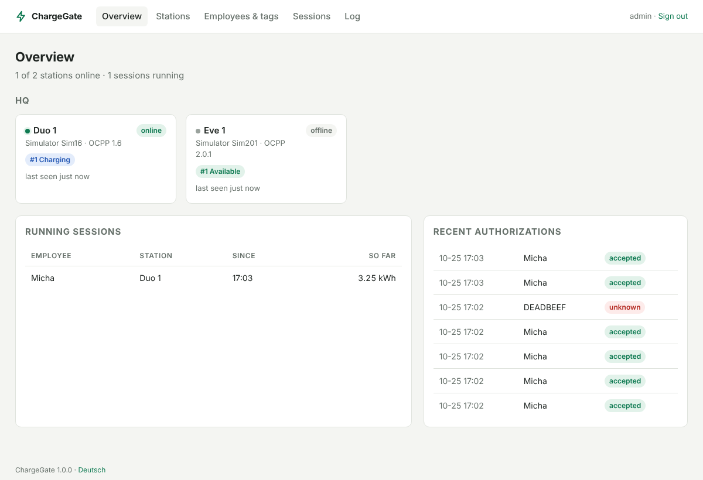

# ChargeGate

**OCPP server for company-wide RFID charging access across multiple sites.**

Employees hold their RFID tag against any charging station at any site – ChargeGate checks the
tag centrally and lets them charge. Energy per session is recorded for internal reporting.
Runs as a **Home Assistant app** (e.g. on a Home Assistant Green) or **standalone with Docker**.



## Features

- **OCPP 1.6J and 2.0.1** – mixed fleets of different vendors in one system
- **One tag, every site** – tags and employees are managed centrally
- **Onboarding by tapping** – hold a new tag against a station, then assign it in the UI
- **Offline-capable** – the list of valid tags is pushed to the stations (`SendLocalList`)
  and their cache is cleared, so charging keeps working during outages and blocked tags stop immediately
- **Station approval** – unknown stations are detected but rejected until an admin approves them;
  optional basic auth per station
- **Sessions & energy** – kWh per session and employee, filter by month/site, CSV export
- **Home Assistant entities** – who is charging, power and energy per charging point,
  ready for the Energy dashboard (MQTT discovery, see [docs](docs/home-assistant.md))
- **Microsoft Entra ID (optional)** – import employees and tags from a group, block leavers automatically,
  admin sign-in with Microsoft (standalone)
- **English and German UI**
- Robust towards real-world quirks: reversed UID byte order, UIDs with colons, kWh vs Wh meters,
  signed (calibration-law) meter values, stations that append their ID to the URL themselves

## Quick start

### Home Assistant

1. **Settings › Apps › Install app › ⋮ › Repositories** → add
   `https://github.com/kultikom/chargegate`
2. Install **ChargeGate**, start it and open **ChargeGate** in the sidebar
3. Point your stations to the address shown on the *Stations* page, e.g. `ws://192.168.1.10:9000/ocpp/`
4. Optional: install the **Mosquitto broker** app – the stations then appear as devices in Home Assistant

Details: [chargegate/DOCS.md](chargegate/DOCS.md)

### Docker

```bash
git clone https://github.com/kultikom/chargegate && cd chargegate
cp .env.example .env          # set SECRET_KEY and ADMIN_PASSWORD
docker compose up -d --build
```

Web UI on `http://<host>:8080`, stations connect to `ws://<host>:9000/ocpp/`.
Put the web UI behind a reverse proxy with HTTPS for production use.

## How it works

```
Stations (all sites, via VPN) ── ws://server:9000/ocpp/<id> ──┐
                                                              ├── ChargeGate ── SQLite / PostgreSQL
Admins (internal / HA sidebar) ── web UI ─────────────────────┘        │
                                                                 Entra ID (optional)
```

The OCPP port and the web UI run on separate ports, so a firewall can allow station networks to
reach port 9000 only. ChargeGate is meant for **internal networks** (e.g. sites connected by VPN);
it speaks plain `ws://` – put a TLS-terminating proxy in front if stations connect over the internet.

## Documentation

- [Home Assistant app](chargegate/DOCS.md)
- [Charging station setup](docs/chargers.md) – Compleo ducto, Alfen Eve Single and general hints
- [Home Assistant entities & Energy dashboard](docs/home-assistant.md)
- [Microsoft Entra ID](docs/entra-id.md) – employee sync and admin sign-in
- [Configuration reference](docs/configuration.md)
- [Development & testing](docs/development.md) – including a station simulator

## Supported stations

Any station speaking OCPP 1.6J or 2.0.1 should work. Setup notes exist for:

| Station | OCPP | Status |
|---|---|---|
| Compleo ducto Duo (FW 6.5) | 1.6J | setup documented, field test pending |
| Alfen Eve Single Pro-line / Pro-line DE | 1.6J | setup documented, field test pending |

Has ChargeGate worked with your station? A pull request for this table is very welcome.

## Limitations

- No remote commands in the UI yet (stop session, reset)
- Energy values are for internal reporting; billing compliant with German calibration law
  (Eichrecht) is out of scope

## License

[MIT](LICENSE) © KULTIKOM
