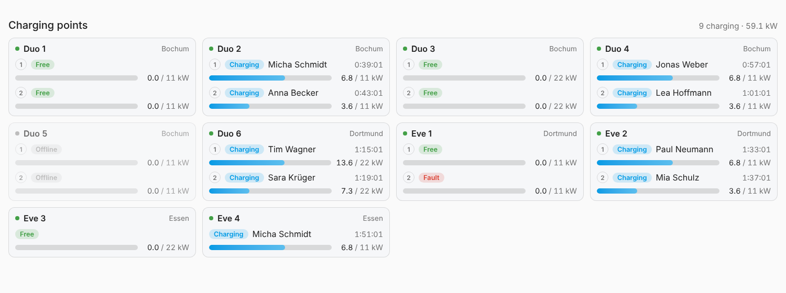

# Home Assistant entities and Energy dashboard

ChargeGate publishes every approved station to Home Assistant via **MQTT discovery**.
Each station becomes a device; the entities appear automatically.

## Requirements

- **Home Assistant app:** install the **Mosquitto broker** app and the **MQTT** integration.
  ChargeGate picks up the broker credentials from the Supervisor automatically – nothing to configure.
  Using another broker? Fill in `mqtt_host`, `mqtt_port`, `mqtt_username`, `mqtt_password`.
- **Standalone:** set `MQTT_ENABLED=true`, `MQTT_HOST` (and `MQTT_USERNAME` / `MQTT_PASSWORD`)
  to the broker your Home Assistant uses.

## Entities

Per station:

| Entity | Type | |
|---|---|---|
| Online | binary sensor (connectivity) | station connected to ChargeGate |

Per connector (prefixed with "Connector N" on stations with several connectors, e.g. Compleo Duo):

| Entity | Type | Unit | Notes |
|---|---|---|---|
| State | sensor | | Free, Charging, **Done**, Paused, Connected, Fault, Offline – in plain words (see below); attribute `phase` holds a language-independent code for automations |
| Status | sensor | | raw OCPP status: Available, Charging, SuspendedEV, Faulted, …, `Offline` – carries the full connector state as attributes |
| Charging | binary sensor | | a session is running |
| Power | sensor | W | needs `Power.Active.Import` in the meter values (set automatically for OCPP 1.6) |
| Energy | sensor | kWh | the station's energy register – `total_increasing` |
| Session energy | sensor | kWh | energy of the running session |
| Employee | sensor | | who is charging – see *Privacy* |
| Battery | sensor | % | car's state of charge – **only created once the station has reported it** (see below) |

On the **ChargeGate** hub device: *Running sessions* and *Stations online*.

## Charging point dashboard



The card `custom:chargegate-card` shows every charging point with

- **state:** offline, free, charging, **done** (with how long the car has been standing there full),
  paused, connected, fault
- **live power** as a bar, scaled to the charging point's maximum – learned automatically: 11 kW,
  or 22 kW as soon as more than 11.5 kW was measured once (stored, survives restarts)
- **session duration**, counting live
- **employee** charging (respecting the privacy option below)
- **battery level** of the car, if the station reports it (`show_soc: false` hides it)

**Home Assistant app:** with *Install the charging point dashboard* enabled (default), ChargeGate copies
the card to `/config/www/chargegate/`, registers it as a dashboard resource and creates the dashboard
**Charging points** once. If the `www` folder did not exist before, Home Assistant shows a notification
asking for one restart. The dashboard is yours afterwards – edit or delete it, it won't be recreated.

**Standalone / manual:** copy `chargegate/app/static/chargegate-card.js` to `/config/www/chargegate/`,
add `/local/chargegate/chargegate-card.js` as a *JavaScript module* under
*Settings › Dashboards › ⋮ › Resources*, then add the card:

```yaml
type: custom:chargegate-card
title: Charging points        # optional
site: Head office             # optional: only stations of this site
stations: [DUO-01, EVE-01]    # optional: only these station IDs, in this order
columns: 2                    # optional: fixed number of columns (default: responsive)
show_employee: true           # optional
show_soc: true                # optional: battery level, if reported
```

For a full-screen view (e.g. a wall tablet) put it into a view of type **Panel**.

## When is a car "done"?

A wallbox doesn't know the battery level (see below), so ChargeGate decides from the power:

| State | `phase` | Rule |
|---|---|---|
| Charging | `charging` | power is flowing (or stopped less than 3 minutes ago) |
| **Done** | `done` | energy was delivered and no power has flowed for 3 minutes – full, or the car's own charge limit (e.g. 80 %) |
| Paused | `paused` | the station holds back (`SuspendedEVSE`, e.g. load management) |
| Connected | `connected` | session started, nothing charged yet |

A car that pauses by itself mid-charge (e.g. departure timer, cheap-rate schedule) also shows **Done** –
without the battery level that can't be told apart. Standalone: the 3 minutes can be changed with
`DONE_AFTER_S`.

## Battery level (SoC)

Plain AC charging (Type 2 wallboxes, IEC 61851) has no way to transmit the car's battery level –
the station simply doesn't know it. DC chargers and stations using ISO 15118 (with a car that
supports it) can send it as OCPP measurand `SoC`. ChargeGate requests it from every OCPP 1.6 station
and shows it as soon as it arrives; nothing changes for stations that don't support it.

## Energy dashboard

**Settings › Dashboards › Energy › Individual devices › Add device** and pick the
**Energy** sensor of each connector. The dashboard then shows how much energy goes into each
charging point. The sensors use the stations' energy register, so nothing is lost when Home
Assistant or ChargeGate restarts.

Tip: for a smooth power reading, lower *Meter value interval* (default 60 s). Stations only send
meter values while charging.

## Privacy

Who is charging is personal data, and everyone with access to Home Assistant can see it.
Choose with the option **Employee shown in Home Assistant** (`HA_EMPLOYEE_DISPLAY`):

| Value | Shown |
|---|---|
| `name` | full name |
| `initials` | e.g. `M.T.` |
| `hidden` | no employee entity at all (an existing one is removed) |

The ChargeGate web UI always shows the full name to its admins.

## Topics

All messages are retained.

| Topic | Content |
|---|---|
| `chargegate/status` | `online` / `offline` (last will) |
| `chargegate/<station>/online` | `ON` / `OFF` |
| `chargegate/<station>/<connector>/state` | JSON: status, charging, power, energy, session_energy, employee |
| `chargegate/hub/state` | JSON: running, online |
| `homeassistant/…/config` | discovery |

Deleting a station in ChargeGate removes its device from Home Assistant.

## Example automations

Tell the employee's team when a car is done (works in any UI language thanks to the `phase` attribute):

```yaml
triggers:
  - trigger: state
    entity_id: sensor.duo_1_connector_1_state
    attribute: phase
    to: done
actions:
  - action: notify.notify
    data:
      message: >
        {{ state_attr('sensor.duo_1_connector_1_status', 'employee') }}: your car at
        Duo 1 is done – please move it so others can charge.
```

Notify when a charging point is free again:

```yaml
triggers:
  - trigger: state
    entity_id: binary_sensor.duo_1_connector_1_charging
    from: "on"
    to: "off"
actions:
  - action: notify.notify
    data:
      message: "Charging point Duo 1 / 1 is free again"
```
